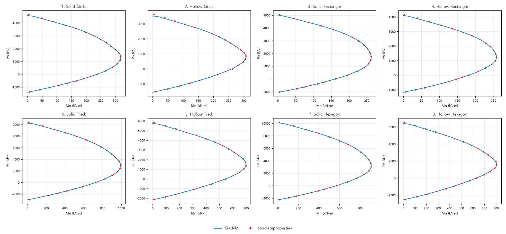
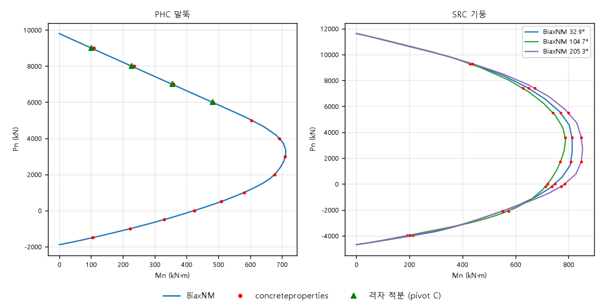

# BiaxNM 과 concreteproperties 0.8.0 비교 (Eurocode 2)

## 해석 조건

| 항목 | 철근콘크리트 8단면 | PHC 말뚝 | SRC 기둥 |
|---|---|---|---|
| 설계기준 | `ec2-05-2`, na UK | `ec2-04-1-1`, na EN | `ec2-04-1-1`, na EN |
| 콘크리트 | fck 30, fcd = 0.85 x 30 / 1.5 = 17 MPa, εc2 0.002, εcu2 0.0035, n 2 | fck 80, fcd = 53.3 MPa, εc2 2.52‰, εcu2 2.60‰, n 1.40 | fck 30, fcd = 20 MPa, εc2 0.002, εcu2 0.0035, n 2 |
| 철근 | fy 500, fyd 434.8 MPa | - | fy 400, fyd 347.8 MPa |
| 긴장재 | - | fpy 1275, fpd 1108.7 MPa, Ep 200 GPa, fse 700 MPa | - |
| 형강 | - | - | Fy 355 MPa |
| 단면 | 원형, 사각형, 트랙형, 육각형 각각 속찬 것과 속빈 것 8개 (`cases/biaxnm/input/case1~8`) | Ø600 / Ø340 중공 원형, PC강봉 24개 (반지름 235 mm 원, 71 mm²) | 600 x 600, H300x200x10x16, D25 8개 (`examples/src_ec2-04-1-1.toml`) |
| 하중 방향 | Mx = My (45°) | 0, 7.5, 11, 22.5, 33.3, 45° | 32.9, 104.7, 205.3° (이축휨) |
| 축력 N | 순인장 ~ 0.995 P0 | -1500 ~ 9000 kN (14개) | 순인장의 85% ~ 0.8 P0 (9개) |
| 모멘트 기준 | 도심 (원점) | 콘크리트 외곽 도심 | 콘크리트 외곽 도심 |

공통 조건

| 항목 | 내용 |
|---|---|
| 재료 모델 | 콘크리트 포물선-직선, 철근·형강·긴장재 탄성-완전소성 (Es = 200 GPa, 변형률 제한 없음) |
| 공제 | 철근·긴장재 면적만큼, 형강 영역만큼 콘크리트를 비운다 (두 프로그램 동일) |
| 비교 값 | 같은 N 에서 하중 방향의 공칭 휨강도 Mn |
| 변형률 평면 | BiaxNM: EC2 pivot B / C (순수 압축 εc2). concreteproperties: 압축 연단 εcu2, 중립축 깊이 변화 |
| concreteproperties 해석 | `ultimate_bending_capacity(theta, n)` 에서 모멘트 방향이 하중 방향과 같아지는 중립축 각도를 푼다. PHC 는 `PrestressedSection` (y축 대칭, x축 휨만 가능) 이라 하중 방향만큼 단면을 회전해 단축 휨으로 푼다 |
| 단면 형상 | BiaxNM 결과 csv (`cases/biaxnm/result`) 의 콘크리트, 철근, 긴장재, 형강 좌표를 그대로 사용 |
| 오차 | 철근콘크리트: 같은 N 의 \|ΔM\| / BiaxNM 최대 M. PHC·SRC: 점별 (BiaxNM / concreteproperties - 1) |

## 결과

| 구분 | 구간 | 평균 | 최대 |
|---|---|---|---|
| 철근콘크리트 8단면 | N < 0.6 P0 | 0.02% | 0.09% |
| 철근콘크리트 8단면 | 전체 | - | 2.87% (N / P0 0.97) |
| PHC 말뚝 | N ≤ 0.5 P0 | 0.031% | 0.085% |
| PHC 말뚝 | 전체 | 0.95% | 7.98% (N 9000 kN) |
| SRC 기둥 | 전체 (27점) | 0.141% | 0.549% |

### 철근콘크리트 8단면

| # | 단면 | N < 0.6 P0 오차 평균 / 최대 | 전체 최대 오차 (N / P0) | P0 CP / BiaxNM (kN) | 순인장 CP / BiaxNM (kN) | Md(N=0) CP / BiaxNM (kN·m) |
|---|---|---|---|---|---|---|
| 1 | Solid Circle | 0.02% / 0.05% | 2.55% (0.96) | 4680 / 4560 (-2.6%) | -1399 / -1399 | 237.0 / 237.1 |
| 2 | Hollow Circle | 0.02% / 0.06% | 2.87% (0.97) | 3647 / 3513 (-3.7%) | -1574 / -1574 | 262.2 / 262.0 |
| 3 | Solid Rectangle | 0.02% / 0.06% | 2.15% (0.95) | 5088 / 5001 (-1.7%) | -1049 / -1049 | 161.7 / 161.7 |
| 4 | Hollow Rectangle | 0.02% / 0.06% | 2.62% (0.96) | 4194 / 4096 (-2.3%) | -1180 / -1180 | 181.3 / 181.4 |
| 5 | Solid Track | 0.02% / 0.07% | 2.09% (0.96) | 10475 / 10221 (-2.4%) | -3005 / -3005 | 727.4 / 727.4 |
| 6 | Hollow Track | 0.02% / 0.05% | 2.31% (0.97) | 5915 / 5732 (-3.1%) | -2164 / -2164 | 544.5 / 544.5 |
| 7 | Solid Hexagon | 0.02% / 0.06% | 1.74% (0.95) | 10259 / 10068 (-1.9%) | -2273 / -2273 | 569.7 / 569.7 |
| 8 | Hollow Hexagon | 0.02% / 0.09% | 2.17% (0.97) | 6619 / 6406 (-3.2%) | -2557 / -2557 | 629.2 / 629.2 |

### PHC 말뚝과 SRC 기둥

PHC 말뚝 (φ = 0°, 다른 방향도 같은 값)

| N (kN) | -1500 | 0 | 1000 | 3000 | 5000 | 6000 | 7000 | 8000 | 9000 |
|---|---|---|---|---|---|---|---|---|---|
| BiaxNM Mn (kN·m) | 104.8 | 424.5 | 580.7 | 710.6 | 604.5 | 481.1 | 353.9 | 227.0 | 100.5 |
| concreteproperties | 104.9 | 424.4 | 580.7 | 710.2 | 604.2 | 482.3 | 358.8 | 234.8 | 109.2 |
| 차이 | -0.08% | +0.02% | +0.02% | +0.07% | +0.05% | -0.25% | -1.4% | -3.3% | -8.0% |
| 격자 적분 (pivot C) | - | - | - | - | - | 482.5 | 355.2 | 228.2 | 101.6 |

격자 적분은 1 mm 격자로 직접 적분한 값이다 (EC2 pivot B / C 변형률 평면).

SRC 기둥

| 하중 방향 | 점 수 | 평균 | 최대 |
|---|---|---|---|
| 32.9° | 9 | 0.122% | 0.327% |
| 104.7° | 9 | 0.206% | 0.549% |
| 205.3° | 9 | 0.095% | 0.308% |
